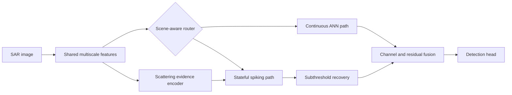

# D²ES-Net

**Scene-Adaptive ANN-SNN Routing and Scattering-Evidence-Guided Spiking for SAR Ship Detection**

> **Repository status:** private research snapshot under manuscript review.  
> Complete training integration, experiment manifests, checkpoints, and
> pretrained weights will be released after paper acceptance.

D²ES-Net is a hybrid continuous-spiking perception framework for dense small
ship detection in synthetic aperture radar (SAR) imagery. The method addresses
two coupled limitations of fixed-computation detectors: the mismatch between
scene complexity and ANN-SNN resource allocation, and the loss of weak
scattering responses caused by binary spike encoding.

## Method overview

The implementation is organized around three interacting components.

### 1. Scene-adaptive ANN-SNN routing

Multiscale local contrast, directional scattering, and spatial statistics are
encoded into a compact scene descriptor. A lightweight router predicts
probabilities over the ANN channel ratios
\(\{0.25, 0.50, 0.75\}\). All candidate widths are evaluated during training,
whereas only the highest-probability width is executed during inference.

Relevant code:

- `d2esnet/router.py`
- `d2esnet/block.py`

### 2. Scattering-evidence-driven stateful spiking

The selected SNN channels are unfolded over multiple internal time steps. Each
step receives a distinct spatial evidence map produced from multiscale
contrast and directional scattering responses. The evidence modulates
leaky-integrate-and-fire membrane accumulation and spike firing.

Relevant code:

- `d2esnet/evidence.py`
- `d2esnet/ops.py`
- `d2esnet/layers.py`

### 3. Evidence-gated subthreshold recovery

For neurons that do not fire, the final residual membrane potential and
aggregated scattering evidence are combined into a selective recovery gate.
The recovered response is added to the spike-derived feature in a bounded
residual form, thereby reducing weak-target information loss while limiting
background compensation.

Relevant code:

- `d2esnet/evidence.py`
- `d2esnet/block.py`

## Processing flow



## Repository scope

This snapshot contains the method-specific implementation and documentation.
It intentionally excludes benchmark figures, prediction dumps, datasets, and
pretrained checkpoints, which are managed separately for the manuscript.

```text
D2ESNet/
├── d2esnet/
│   ├── block.py          # Dynamic hybrid ANN-SNN block
│   ├── evidence.py       # Evidence encoding, LIF dynamics, recovery
│   ├── layers.py         # Binary spike surrogate and elastic ANN path
│   ├── metrics.py        # Routed FLOPs and SNN channel allocation
│   ├── ops.py            # Scattering feature operators
│   └── router.py         # Scene-context routing and regularization
├── configs/              # HRSID and SRSDD-v1.0 recipes
├── docs/                 # Method, experiments, reproducibility
├── tests/                # Unit tests for core modules
├── LICENSE
├── NOTICE.md
└── THIRD_PARTY_NOTICES.md
```

## Installation

```bash
python -m venv .venv
source .venv/bin/activate
pip install -e ".[dev]"
pytest -q
```

On Windows, activate the environment with:

```powershell
.venv\Scripts\Activate.ps1
```

## Minimal example

```python
import torch
from d2esnet import D2ESBlock

device = "cuda" if torch.cuda.is_available() else "cpu"
block = D2ESBlock(channels=24, time_steps=3).eval().to(device)
features = torch.randn(1, 24, 48, 48, device=device)

with torch.inference_mode():
    output = block(features)

print("output:", tuple(output.shape))
print("selected ANN ratio:", block.last_selected_ratio)
print("selected SNN ratio:", 1.0 - block.last_selected_ratio)
```

## Experimental protocol

The manuscript reports controlled experiments on HRSID and SRSDD-v1.0 with:

- `800 x 800` input resolution;
- batch size `32` and `100` training epochs;
- three independent random seeds;
- no pretrained detector weights;
- COCO-style `mAP50-95`, `AP-small`, and `AR-small`;
- parameter count, model computation, inference latency, and spike activity.

Runtime measurements in the manuscript use an NVIDIA H100 GPU with batch size
1 and FP32 inference. Dataset and protocol details are provided in
[`docs/experiments.md`](docs/experiments.md) and
[`docs/reproducibility.md`](docs/reproducibility.md).

## Reported results

The following values correspond to the manuscript and are not regenerated by
the reduced code snapshot.

| Dataset | mAP50 | mAP50-95 | AP-small | Params (M) | Static GFLOPs |
|---|---:|---:|---:|---:|---:|
| HRSID | 83.94 | 61.09 | 49.77 | 2.0619 | 8.8886 |
| SRSDD-v1.0 | 52.16 | 29.18 | 11.87 | 2.0619 | 8.8886 |

## Reproducibility principles

- Every run is associated with a fixed seed, configuration, checkpoint hash,
  and source revision.
- Static model complexity and data-dependent routed computation are reported
  separately.
- Runtime comparisons follow an identical hardware, input, precision, and batch
  protocol.
- Result files distinguish manuscript-derived values from independently
  reproduced values.

## Availability

The public release after acceptance is planned to include:

1. complete training and evaluation entry points;
2. dataset manifests and split definitions;
3. model configuration and checkpoint hashes;
4. per-image predictions and summarized result tables;
5. final license and third-party notices.

## License and attribution

See `LICENSE`, `NOTICE.md`, and `THIRD_PARTY_NOTICES.md`. Public distribution
will preserve the license and corresponding-source obligations of any upstream
dependency used by the integrated implementation.

