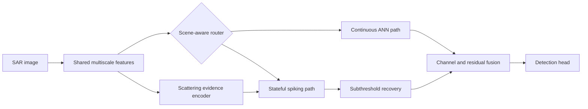

# D²ES-Net

## Scene-Adaptive ANN-SNN Routing and Scattering-Evidence-Guided Spiking for SAR Ship Detection

> **Project status.** Research code accompanying a manuscript under review.
> The complete training stack, experiment manifests, checkpoints, and
> pretrained weights will be released after acceptance.

D²ES-Net is a research framework for dense small-ship detection in synthetic
aperture radar (SAR) imagery. It addresses two coupled limitations of
fixed-computation hybrid ANN-SNN detectors: scene heterogeneity makes a single
ANN-SNN split inefficient, while binary spike encoding can suppress weak
scattering responses from small targets.

This repository contains the method-level implementation and the experimental
protocol required to understand and evaluate the proposed design. It does not
contain benchmark images, prediction dumps, trained weights, or generated
figures.

## Technical overview

D²ES-Net combines three interacting mechanisms.

### 1. Scene-adaptive ANN-SNN routing

A compact scene descriptor is constructed from multiscale local contrast,
directional scattering responses, and spatial activation statistics. A
lightweight router predicts a distribution over ANN channel ratios
`{0.25, 0.50, 0.75}`. During training, candidates are softly combined
according to the routing distribution. During inference, only the
highest-probability path is executed, making computation dependent on scene
content while retaining a single-path deployment cost.

Implementation: [`d2esnet/router.py`](d2esnet/router.py),
[`d2esnet/block.py`](d2esnet/block.py).

### 2. Scattering-evidence-driven temporal spiking

The selected spiking channels are unfolded over `T` internal steps. Rather
than repeating the input, the evidence encoder produces a distinct spatial map
at each step from multiscale contrast and directional scattering responses.
These maps modulate leaky-integrate-and-fire membrane accumulation and spike
generation, coupling temporal computation with SAR-specific structure.

Implementation: [`d2esnet/evidence.py`](d2esnet/evidence.py),
[`d2esnet/ops.py`](d2esnet/ops.py), and
[`d2esnet/layers.py`](d2esnet/layers.py).

### 3. Evidence-gated subthreshold recovery

For neurons that do not fire, the final post-reset membrane state is combined
with aggregated scattering evidence through a selective recovery gate. The
recovered response is added to the spike-derived feature in a bounded residual
form. This preserves weak-target information while restricting recovery to
spatially supported regions and non-firing neurons.

Implementation: [`d2esnet/evidence.py`](d2esnet/evidence.py),
[`d2esnet/block.py`](d2esnet/block.py).

## Processing flow



## Repository scope

The repository is intentionally limited to the proposed method and its
verification utilities.

```text
D2ESNet/
├── d2esnet/
│   ├── block.py          # Hybrid ANN-SNN block and residual fusion
│   ├── evidence.py       # Evidence encoding, LIF dynamics, recovery
│   ├── layers.py         # Spike surrogate and elastic ANN path
│   ├── metrics.py        # Routed GFLOPs and SNN channel statistics
│   ├── ops.py            # Multiscale and directional scattering operators
│   └── router.py         # Scene-context routing and regularization
├── configs/              # HRSID and SRSDD-v1.0 configurations
├── docs/                 # Method, algorithm, experiments, reproducibility
├── tests/                # Core implementation checks
├── LICENSE
├── NOTICE.md
└── THIRD_PARTY_NOTICES.md
```

Detailed descriptions are provided in [`docs/method.md`](docs/method.md),
[`docs/algorithm.md`](docs/algorithm.md), and
[`docs/reproducibility.md`](docs/reproducibility.md).

## Installation

```bash
python -m venv .venv
source .venv/bin/activate
pip install -e ".[dev]"
pytest -q
```

On Windows:

```powershell
.venv\Scripts\Activate.ps1
```

## Minimal usage

```python
import torch
from d2esnet import D2ESBlock

device = "cuda" if torch.cuda.is_available() else "cpu"
block = D2ESBlock(channels=24, time_steps=3).eval().to(device)
features = torch.randn(1, 24, 48, 48, device=device)

with torch.inference_mode():
    output = block(features)

print("output:", tuple(output.shape))
print("selected ANN ratio:", block.last_selected_ratio)
print("selected SNN ratio:", 1.0 - block.last_selected_ratio)
```

## Experimental protocol

The manuscript evaluates the method on HRSID and SRSDD-v1.0 using:

- `800 × 800` input resolution;
- batch size 32 and 100 training epochs;
- three independent random seeds;
- no pretrained detector weights;
- COCO-style mAP and AP-small metrics;
- static complexity, data-dependent routed computation, latency, and spike
  activity.

Runtime measurements use an NVIDIA H100 GPU with batch size 1 and FP32
inference. Complete protocol details are provided in
[`docs/experiments.md`](docs/experiments.md) and
[`docs/reproducibility.md`](docs/reproducibility.md).

## Manuscript results

The values below are reported in the manuscript. They are not regenerated by
this reduced code snapshot.

| Dataset | mAP50 | mAP50-95 | AP-small | Params (M) | Static GFLOPs |
|---|---:|---:|---:|---:|---:|
| HRSID | 83.94 | 61.09 | 49.77 | 2.0619 | 8.8886 |
| SRSDD-v1.0 | 52.16 | 29.18 | 11.87 | 2.0619 | 8.8886 |

Static GFLOPs characterize nominal model complexity. Data-dependent execution
cost is reported separately as average routed GFLOPs over the test split.
These quantities use different counting conventions and should not be compared
directly.

## Reproducibility principles

- Every run is associated with a fixed seed, configuration, checkpoint hash,
  and source revision.
- Static complexity and routed computation are reported under distinct
  measurement protocols.
- Runtime comparisons use identical hardware, input resolution, numerical
  precision, and batch size.
- Manuscript-derived values and independently reproduced values are labeled
  separately.

## Availability

The release after acceptance is planned to include:

1. complete training and evaluation entry points;
2. dataset manifests and split definitions;
3. model configurations and checkpoint hashes;
4. per-image predictions and summarized result tables;
5. final license and third-party notices.

## Citation

Citation metadata will be updated when the manuscript is accepted.

## License and attribution

See [`LICENSE`](LICENSE), [`NOTICE.md`](NOTICE.md), and
[`THIRD_PARTY_NOTICES.md`](THIRD_PARTY_NOTICES.md). Public distribution will
preserve all applicable license and corresponding-source obligations.
